# Figures

Index of the figures in the manuscript and the supplementary material (generated by latex/gen_figures_md.py; captions as in the text). Each figure is available as PNG and PDF in `figures/`.

## Main text

### Figure 1

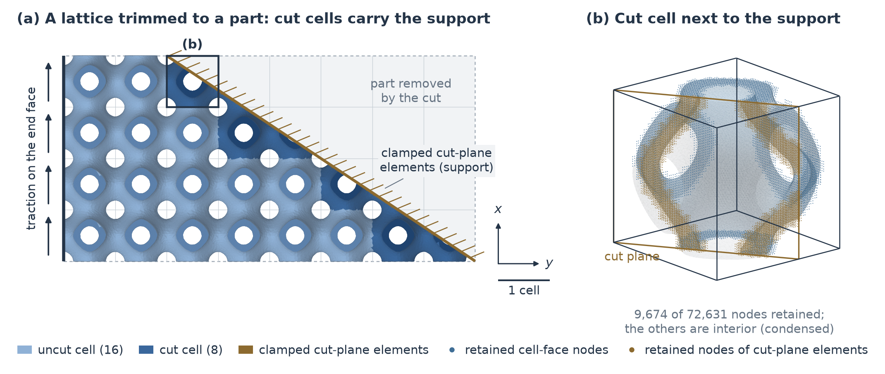

**Figure 1. A lattice trimmed to the shape of a part and clamped at its cut.** (a) \(8\times4\) Schwarz-P cells (\(\tau=0.40\)) after a planar cut, leaving 16 uncut cells (light) and eight cut cells (dark); all degrees of freedom of the cut-plane elements are fixed (hatched line), and the end face carries an in-plane traction (arrows). (b) The cut cell outlined in (a): of its 72,631 nodes, the 9,674 nodes on the cell faces (blue) and in the cut-plane elements (sand) are retained, and the other nodes are eliminated by static condensation.

[PNG](figures/F00_problem.png) · [PDF](figures/F00_problem.pdf)

### Figure 2

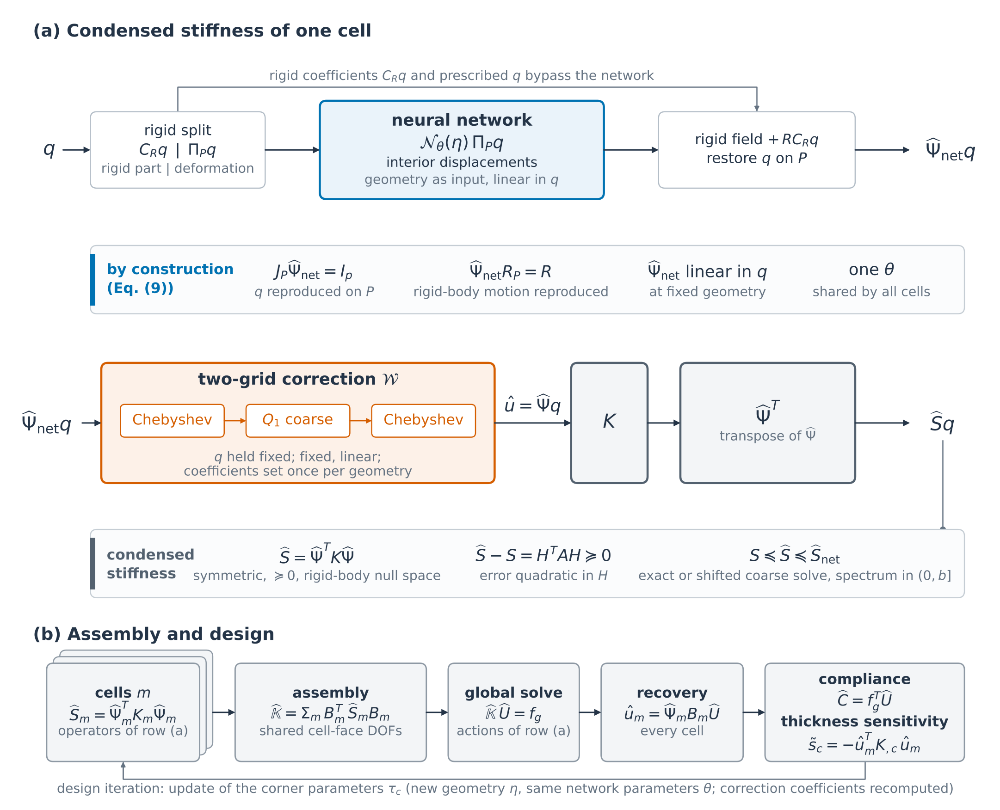

**Figure 2. Overview of NICE.** (a) One cell: after the rigid-body part is separated, the network predicts the interior displacements from the retained displacements; adding back the rigid-body field and restoring the retained displacements gives \(\widehat\Psi_{\rm net}q\). The two-grid correction \(\mathcal W\) reduces the interior force imbalance, which gives \(\widehat u=\widehat\Psi q\), and applying \(K\) and then \(\widehat\Psi^T\) gives the nodal forces \(\widehat Sq\). \(\widehat S_{\rm net}\) is the condensed stiffness without correction, and the ordering in (a) is that of Proposition 2. (b) Assembly and design: the condensed stiffness matrices of the cells are assembled on the shared cell-face DOFs and solved, and the recovered cell displacements give the compliance and the thickness sensitivities; each design iteration updates the corner thickness parameters, with the network parameters unchanged and the coefficients of \(\mathcal W\) recomputed.

[PNG](figures/F01_method_overview.png) · [PDF](figures/F01_method_overview.pdf)

### Figure 3

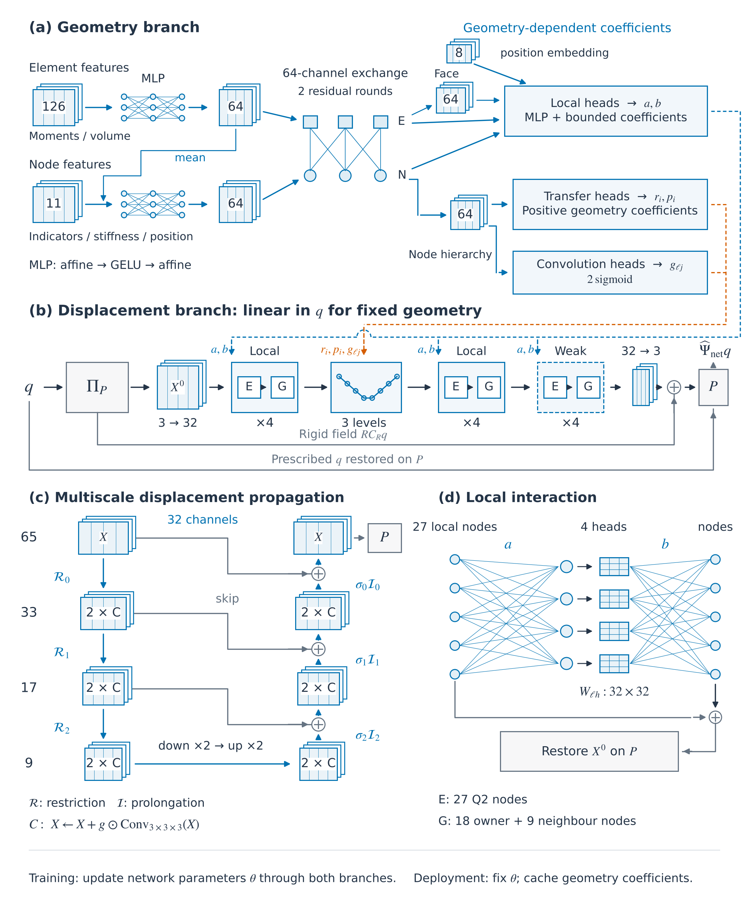

**Figure 3. Architecture of the network for the interior displacements.** (a) Geometry branch: element and node encoders produce geometry features, which pass through two rounds of message exchange before coefficient heads compute the coefficients of the local interactions, grid transfers and convolutions. (b) Displacement branch: the retained displacements without their rigid-body part are lifted to 32 feature channels, pass through local interactions, the grid hierarchy and local interactions on stencils with weakly connected nodes (Weak), and are mapped back to displacements; a bypass reconstructs the rigid-body motion and restores the retained displacements. (c) Grid hierarchy: restriction \(\mathcal R\) and interpolation \(\mathcal I\) connect grids with 65, 33, 17 and 9 positions per axis. (d) Local interaction: the features at the 27 nodes of a stencil are gathered into four heads with geometry-dependent weights, mixed within each head and scattered back to the nodes. E and G denote element and ghost-face interactions; dashed arrows carry geometry-dependent coefficients, and solid arrows carry features or displacements.

[PNG](figures/F11_network_architecture.png) · [PDF](figures/F11_network_architecture.pdf)

### Figure 4

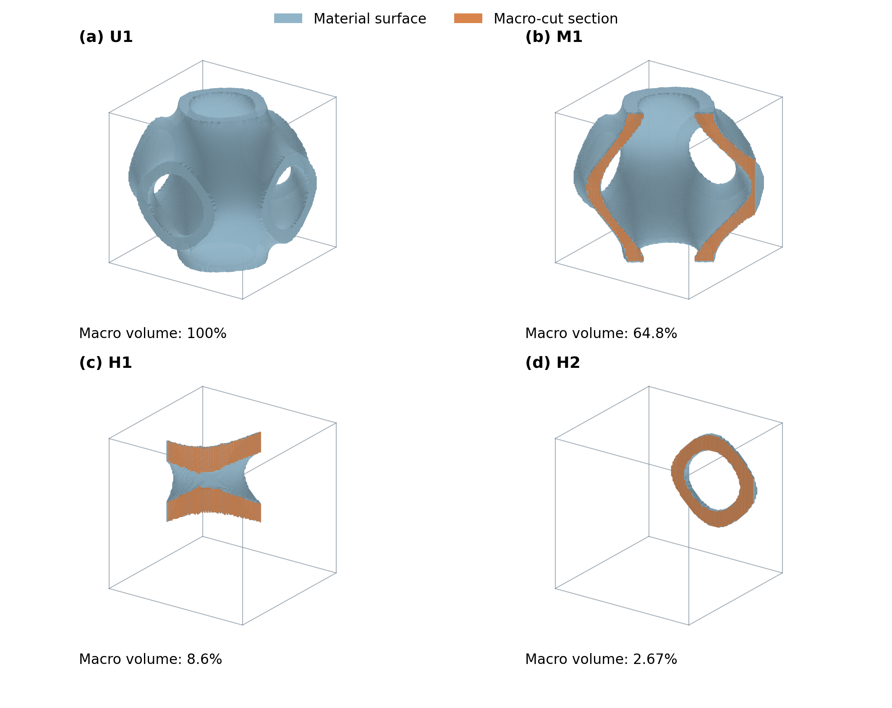

**Figure 4. Representative validation geometries.** (a) Uncut cell U1; (b) moderately cut cell M1; (c,d) heavily cut cells H1 and H2, all viewed from the side of the cut. Light blue shows the material surface, dark blue and sand the material sections on the cell faces and on the cut plane, and translucent grey the part removed by the cut; the percentages give the fraction of the box volume that remains after the cut.

[PNG](figures/F08_geometry.png) · [PDF](figures/F08_geometry.pdf)

### Figure 5

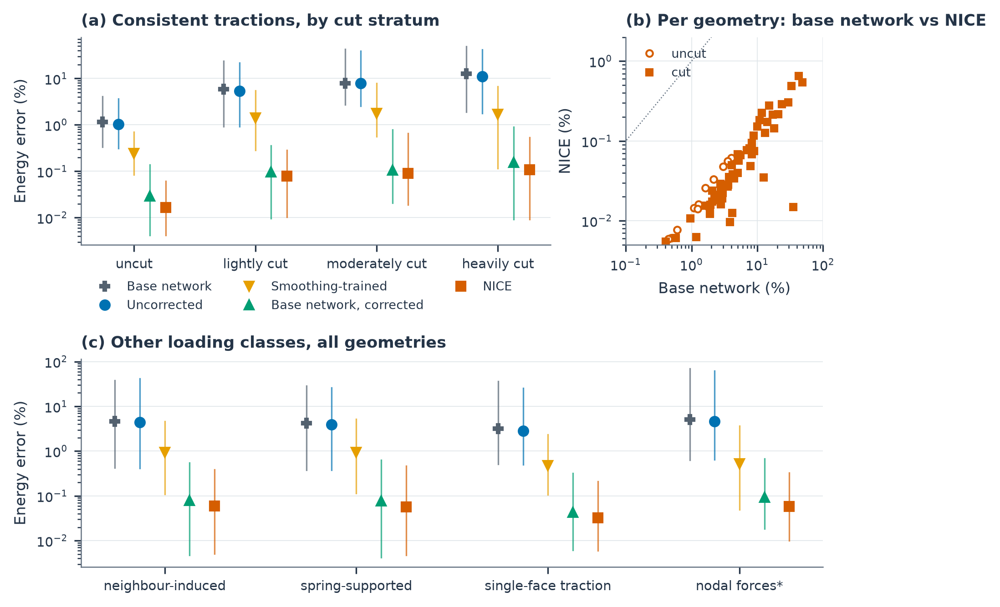

**Figure 5. Energy errors on the 80 validation geometries.** The error of each geometry is its mean over all test displacements of one load class. (a) Traction loads, by cut-severity group; (b) geometry-by-geometry comparison of the base network and NICE under traction loads, one point per geometry, with open markers for uncut and filled markers for cut geometries and the dotted line denoting equality; (c) four further load classes, the first two on 75 geometries and the other two on 80. In (a,c), markers give group means and bars the range from the 10th percentile to the maximum; the asterisk marks the nodal point loads.

[PNG](figures/F02_validation.png) · [PDF](figures/F02_validation.pdf)

### Figure 6

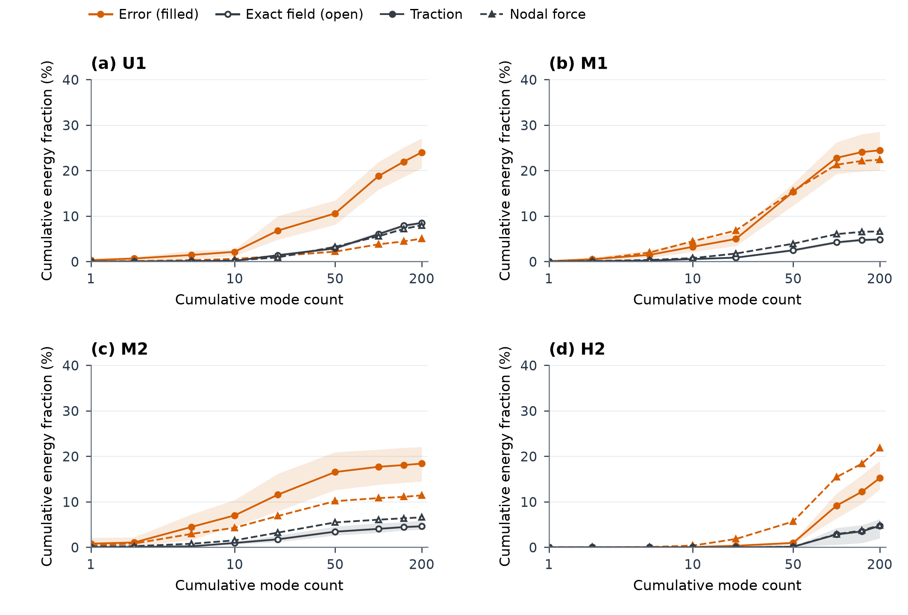

**Figure 6. Spectral distribution of the interior displacement error of the base network.** Panels show U1, M1, M2 and H2. The modes solve \(Av=\lambda Dv\), with \(D=\operatorname{diag}(A)\), in order of increasing eigenvalue; curves give the cumulative energy fraction (mean over the test displacements), normalised by the total interior energy of each field. Filled dark markers denote the error and open light-grey markers the exact interior field; solid lines (circles) denote traction loads and dashed lines (triangles) nodal point loads; bands give the 10th to 90th percentiles under traction loads.

[PNG](figures/F03_spectrum.png) · [PDF](figures/F03_spectrum.pdf)

### Figure 7

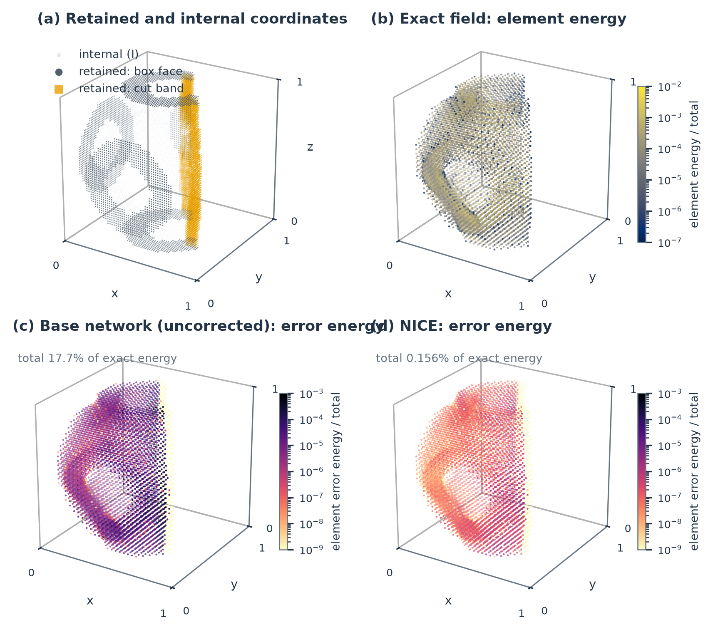

**Figure 7. Retained DOFs and spatial distribution of the interior displacement error in M1.** (a) Retained DOFs on the cell faces and in the cut-plane elements, and interior DOFs. (b) Element energies of the exact field for one traction-load test displacement. (c,d) Element energies of the error of the base network and of NICE for the same retained displacements. Panels (b–d) are normalised by the total energy of the exact field, and (c,d) share a colour scale; the cut-plane elements carry no error because their DOFs are retained.

[PNG](figures/F12_field_error_M1.png) · [PDF](figures/F12_field_error_M1.pdf)

### Figure 8

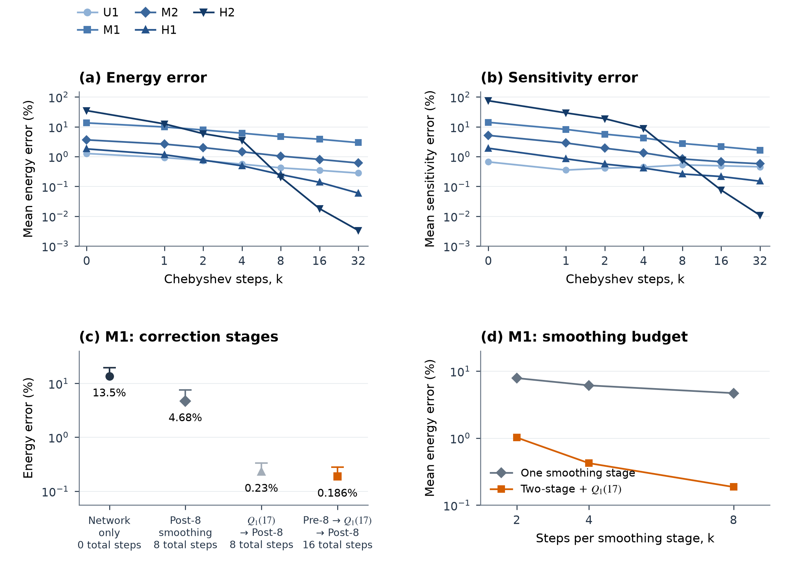

**Figure 8. Correction of the base network with fixed network parameters.** (a,b) Mean energy error and sensitivity error during Chebyshev smoothing on five cells (the step axis is linear from 0 to 1 and logarithmic thereafter). (c) M1 without correction, with eight smoothing steps, with a coarse-grid correction followed by eight steps, and with eight steps on each side of the coarse-grid correction; dots show means and caps the 90th percentile. (d) Mean energy error of M1 against the number \(k\) of steps per smoothing stage, for smoothing alone and for the \(k\) / \(Q_1(17)\) / \(k\) cycle. All panels use traction loads and \(a=b/30\).

[PNG](figures/F04_correction.png) · [PDF](figures/F04_correction.pdf)

### Figure 9

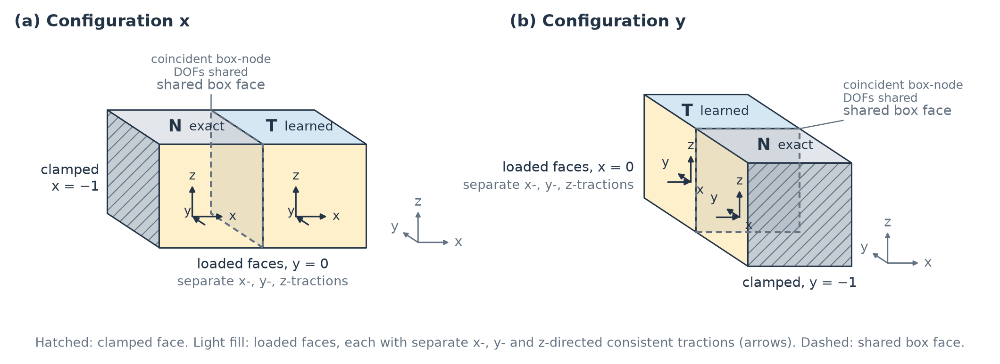

**Figure 9. Supports and loads of the two-cell assemblies.** (a) Configuration x: the neighbouring cell is translated by \((-1,0,0)\), the face \(x=-1\) is clamped, and the traction loads act on the faces at \(y=0\). (b) Configuration y: translation \((0,-1,0)\), face \(y=-1\) clamped, traction loads on the faces at \(x=0\). The loaded faces of the test cell (T) and of the neighbouring cell (N) each carry traction loads in the x, y and z directions; cut test cells also carry three traction loads on the cut surface.

[PNG](figures/F09_assembly_loads.png) · [PDF](figures/F09_assembly_loads.pdf)

### Figure 10

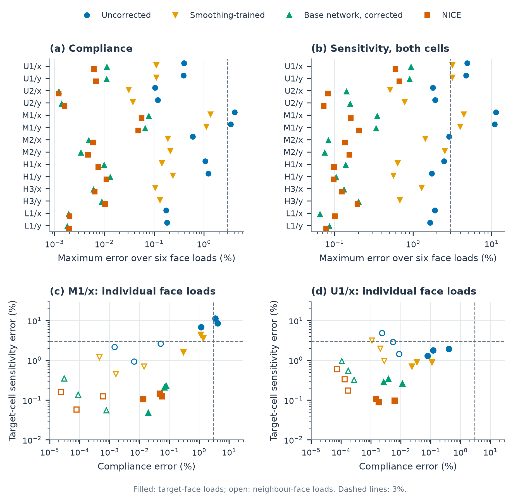

**Figure 10. Compliance and thickness-sensitivity errors in two-cell assemblies.** The test cell is a learned substructure, and the neighbouring cell uses exact static condensation. (a,b) Maximum errors over the six face loads of each configuration; the sensitivity error is also maximised over both cells. (c,d) Results for each face load on M1/x and U1/x; filled markers denote loads on the face of the test cell and open markers loads on the face of the neighbouring cell. Dashed lines mark 3%. Supplementary Table ST08 gives all results.

[PNG](figures/F05_assembly.png) · [PDF](figures/F05_assembly.pdf)

### Figure 11

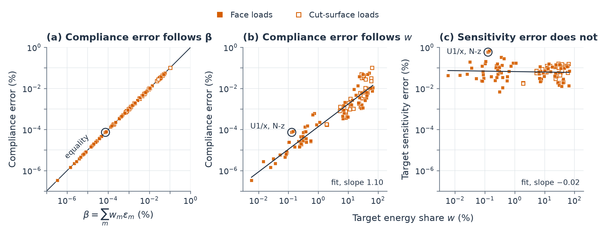

**Figure 11. Compliance and sensitivity errors in two-cell assemblies against the energy fraction of the test cell.** Results of NICE in the fourteen configurations, one point per load (filled: face loads; open: cut-surface loads). (a) Compliance error against \(\beta=\sum_mw_m\varepsilon_m\); the line denotes equality. The compliance error lies between 0.963 and 1.004 times \(\beta\), and the excess of the ratios above 1 is smaller than the residual work of the pair solves (Supplementary Note S4.3). (b) Compliance error and (c) test-cell sensitivity error against the exact energy fraction \(w\) of the test cell; solid lines are least-squares fits in logarithmic coordinates. The circled point is U1/x under the z traction load on the neighbour face.

[PNG](figures/F10_energy_share.png) · [PDF](figures/F10_energy_share.pdf)

### Figure 12

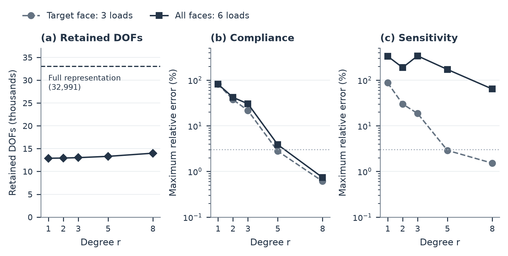

**Figure 12. Response errors caused by restricting the cell-face displacements.** Both cells of H1/x use their exact condensed stiffness, with the cell-face displacements restricted to Bernstein polynomials of degree \(r\); the DOFs of the cut-plane elements off the cell faces remain unrestricted. (a) Number of retained DOFs; the dashed line marks the 32,991 of the full representation. (b,c) Maximum compliance error and test-cell sensitivity error over the three loads on the test-cell face and over all six face loads, relative to the solution with all retained DOFs; horizontal lines mark 3%.

[PNG](figures/F06_bernstein.png) · [PDF](figures/F06_bernstein.pdf)

### Figure 13

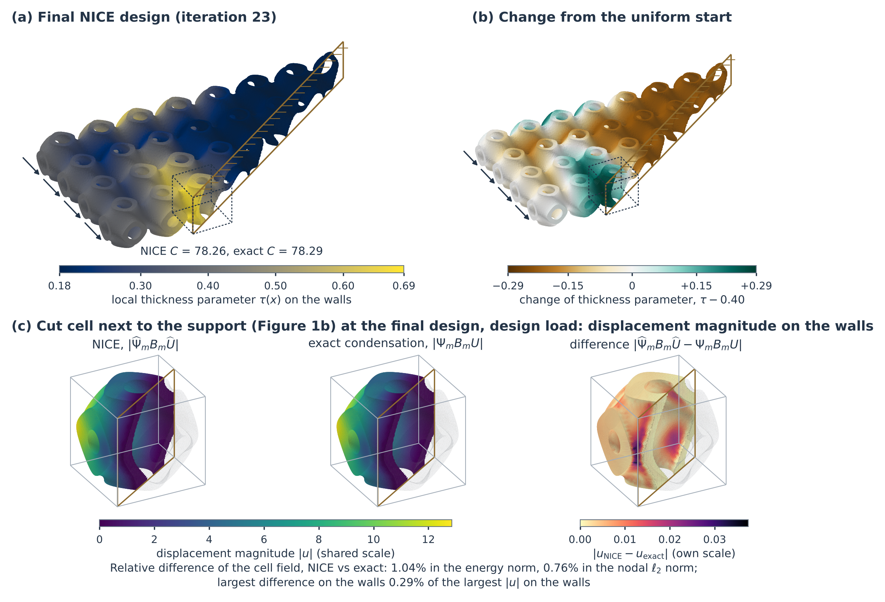

**Figure 13. Thickness design of the plate supported on its cut.** (a) Final NICE design, coloured by the local thickness parameter, with the NICE and exact compliances. (b) Change from the uniform start, \(\tau-0.40\). (c) Displacement magnitude in the cut cell of Figure 1b at the final design: the NICE recovered field \(\widehat\Psi_mB_m\widehat U\) and exact static condensation \(\Psi_mB_mU\) on a common scale, and the magnitude of their difference on a separate scale. The two fields differ by 1.04% in the energy norm of the cell; applying the same recovery to the exact retained displacements gives the same difference, so it comes from the displacement recovery within the cell.

[PNG](figures/F14_plate_design3d.png) · [PDF](figures/F14_plate_design3d.pdf)

### Figure 14

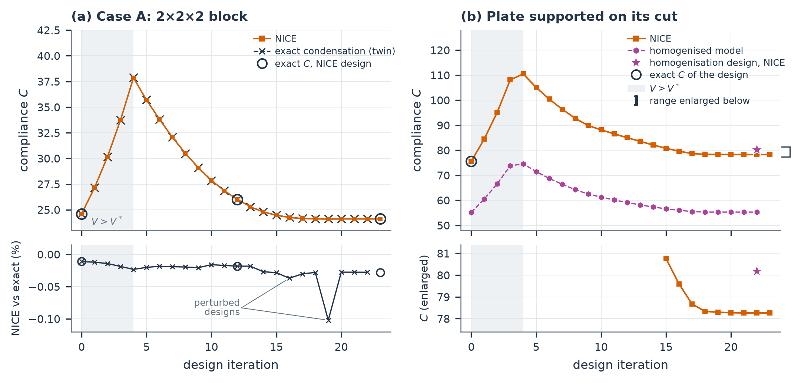

**Figure 14. Thickness optimisation with NICE.** (a) Case A: compliance histories of NICE and of the twin run with exact static condensation; open circles give exact compliances of NICE designs, and shading marks the iterations in which the volume is reduced from \(1.25V^*\) to \(V^*\). The lower strip shows the deviation of the NICE compliance from the twin run at the same iteration (line) and from the exact compliance of the same design (circles); the designs at iterations 16 and 19 were perturbed by the geometry generator (perturbed designs, Supplementary Table ST19a). (b) Plate supported on its cut: NICE compliance and, dashed, the compliance of the homogenised macroscale model along its own optimisation path; the star marks the homogenisation design analysed with NICE on the cut geometry, open circles give exact compliances, shading marks iterations with \(V>V^*\), and the lower strip enlarges the bracketed range.

[PNG](figures/F13_optimisation.png) · [PDF](figures/F13_optimisation.pdf)

### Figure 15

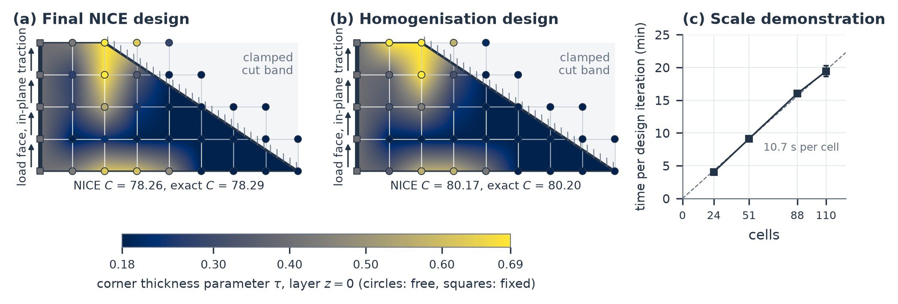

**Figure 15. Designs of the plate supported on its cut.** Corner thickness parameters in the layer \(z=0\) of (a) the final NICE design and (b) the homogenisation design. Circles denote design variables and squares the fixed vertices in the plane of the loaded face; vertices inside the removed region are corners of cut cells. The thick hatched line marks the clamped cut-plane elements and arrows the in-plane traction. The compliances are the NICE and exact values of each design.

[PNG](figures/F14_designs_scale.png) · [PDF](figures/F14_designs_scale.pdf)

### Figure 16

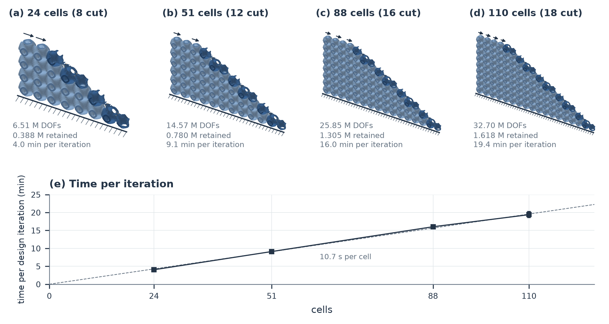

**Figure 16. Plates of the scale study.** (a–d) Plates with 24, 51, 88 and 110 cells at the uniform start \(\tau=0.40\), drawn to the same scale, with the clamped long side hatched and the in-plane traction shown by arrows; light cells are uncut and dark cells cut. Each panel gives the DOFs of the cut finite element model, the free retained DOFs and the mean time of a design iteration. (e) Time of a design iteration against the number of cells: squares give means and bars the range over the timed iterations, and the dashed line is proportional to the number of cells (10.7 s per cell).

[PNG](figures/F16_scale_plates.png) · [PDF](figures/F16_scale_plates.pdf)

## Supplementary material

### Figure S01

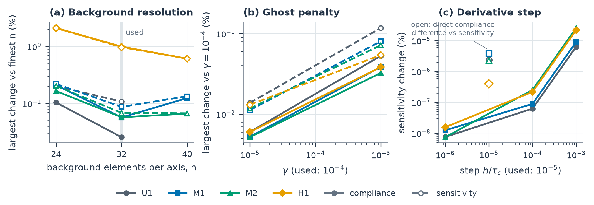

**Figure S01. Verification of the CutFEM reference.** Single cells clamped on one cell face and loaded by unit traction loads on another face in the three Cartesian directions. In (a), (b) and (d), solid lines with filled markers give the compliance and dashed lines with open markers the thickness sensitivity, each as the largest relative change over the three loads. (a) Change against the finest background resolution computed for U1 (\(n=40\)) and for M1 and M2 (\(n=48\)); the reference used throughout has \(n=32\). (b) Change when the ghost-penalty coefficient is varied from the value \(10^{-4}\) used throughout. (c) Filled: largest relative change of the sensitivity when the finite-difference step of the moment derivatives is varied from the value \(h_c=10^{-5}\tau_c\) used throughout, at most \(2.6\times10^{-5}\)% at \(10^{-3}\tau_c\) and a hundredfold smaller at \(10^{-4}\tau_c\); open: largest relative difference between central compliance differences and the sensitivity at the step used. (d) Refinement to \(n=64\) of H1, H2 and the validation cells with the largest NICE error (W1) and the thinnest walls (W3), the data of Table ST10; H2 has no \(n=56\) solution.

[PNG](figures/S06_reference_verification.png) · [PDF](figures/S06_reference_verification.pdf)

### Figure S02

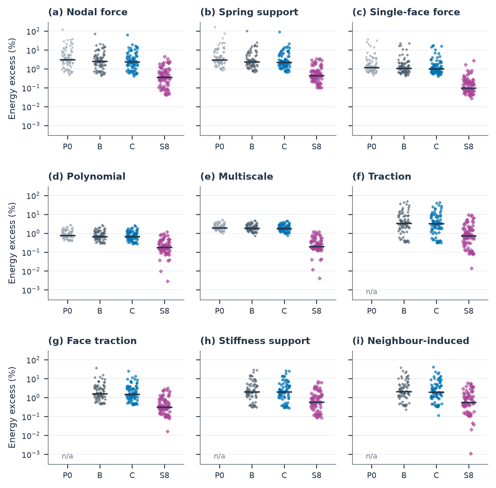

**Figure S02. Distributions of geometry-level energy errors.** Each point is one validation geometry's mean energy error in the identity orientation; horizontal bars are population medians. The classes with nodal point loads, spring supports, single-face nodal point loads, polynomial displacements, multiscale displacements, traction loads and single-face traction loads contain 80 geometries. The class with stiffness-scaled supports and the class with displacements imposed by a neighbouring cell contain 75, the same populations as Table ST03. The five variants of Table ST03 (Base network, Uncorrected continuation, Smoothing-trained, Base network + correction and NICE) use the markers and colours of the main-text figures and of Figure S04; Base network + correction applies the correction to the base network at deployment. Deterministic horizontal offsets separate overlapping observations. All panels share the logarithmic error axis.

[PNG](figures/S01_distributions.png) · [PDF](figures/S01_distributions.pdf)

### Figure S03

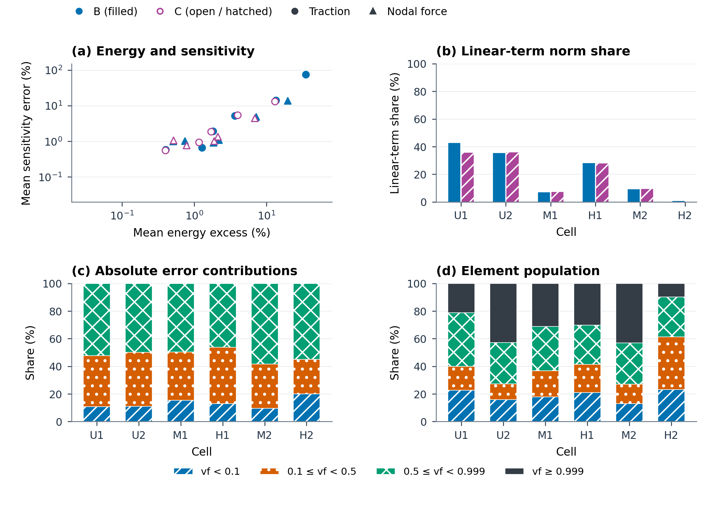

**Figure S03. Sensitivity-error diagnostics.** (a) Paired mean energy and sensitivity errors for responses to traction loads and nodal point loads, using six cells of the base network and five of the Uncorrected continuation. (b) Linear-term norm fraction \(\|D_1\|_F/(\|D_1\|_F+\|D_2\|_F)\) under traction loads, where \(D_1+D_2\) is the sensitivity-error matrix over all eight design components and evaluated test displacements. (c,d) Fractions of absolute elementwise sensitivity-error contributions and of element counts in four mutually exclusive material-volume-fraction groups for the base network under traction loads. Each error group sums absolute contributions over its elements, design components and test displacements before normalisation by the total. Filled markers identify the base network. In (a,b), open markers and hatched bars identify the Uncorrected continuation, which is shown for U1, U2, M1, H1 and M2 (Table ST05a).

[PNG](figures/S03_sensitivity_diagnostics.png) · [PDF](figures/S03_sensitivity_diagnostics.pdf)

### Figure S04

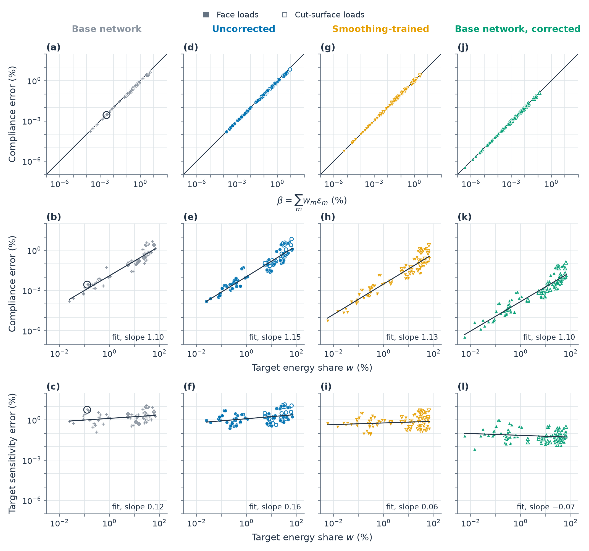

**Figure S04. The other four variants follow the relations of Figure 11.** The counterpart of Figure 11 for (a–c) the base network, (d–f) the Uncorrected continuation, (g–i) the Smoothing-trained variant and (j–l) Base network + correction, which applies the correction at deployment. One point per load in the configurations evaluated for each variant (54, 87, 96 and 114 loads; Tables ST08 and ST09); filled markers denote face loads and open markers cut-surface loads. Top row: compliance error against \(\beta\); lines denote equality. The ratio of compliance error to \(\beta\) lies between 0.80 and 0.98, 0.79 and 0.99, 0.92 and 0.99, and 0.96 and 1.006 for the four variants; the six ratios above 1 correspond to at most \(1.3\times10^{-9}\) of the compliance. Middle and bottom rows: compliance error and test-cell sensitivity error against the exact energy fraction \(w\) of the test cell; lines are least-squares fits in logarithmic coordinates, with the slope given in each panel. All panels share the error axis. The circled load in (a–c) is U1/x under the z traction load on the face of the neighbouring cell; its values are given in the note to Table ST08.

[PNG](figures/S07_energy_share_variants.png) · [PDF](figures/S07_energy_share_variants.pdf)
